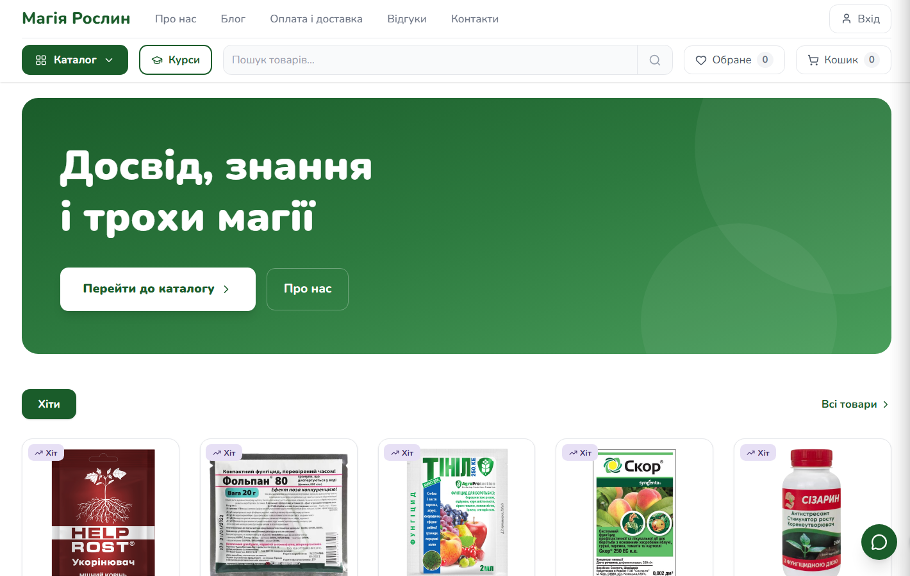
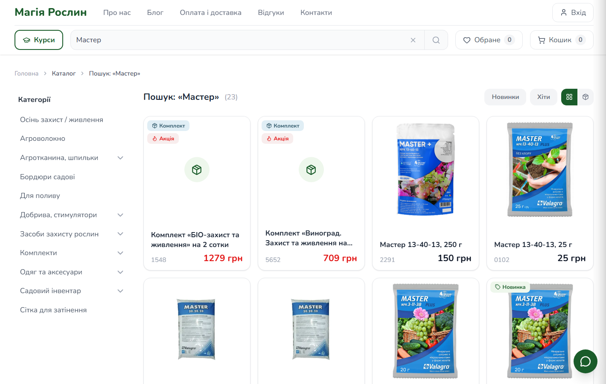
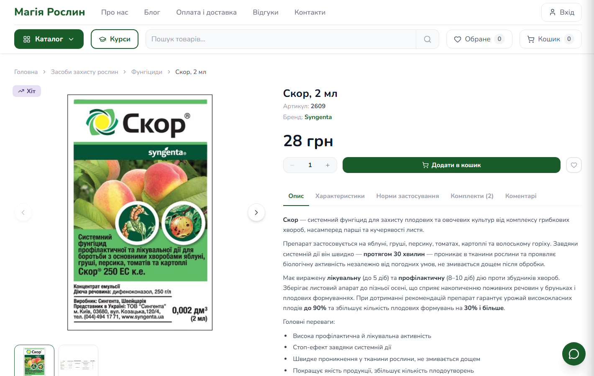
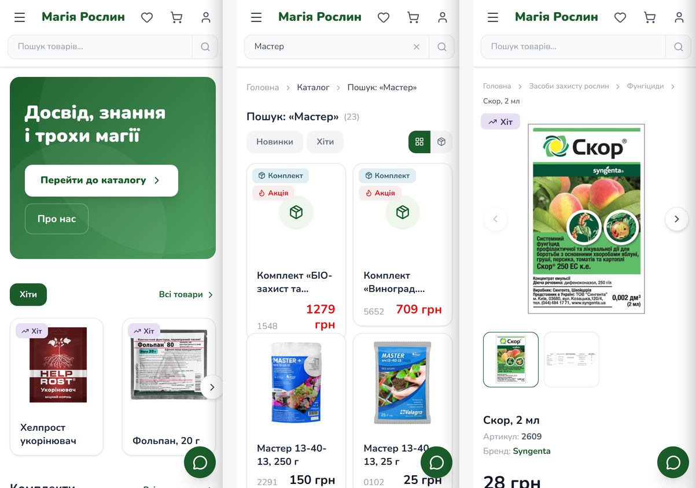
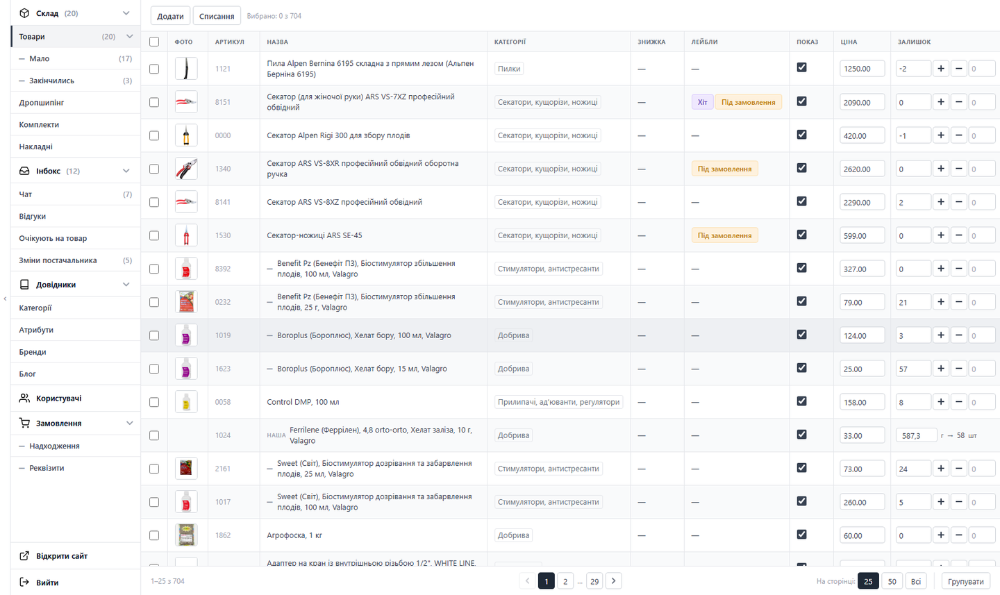
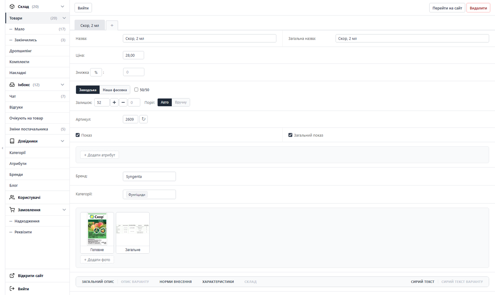
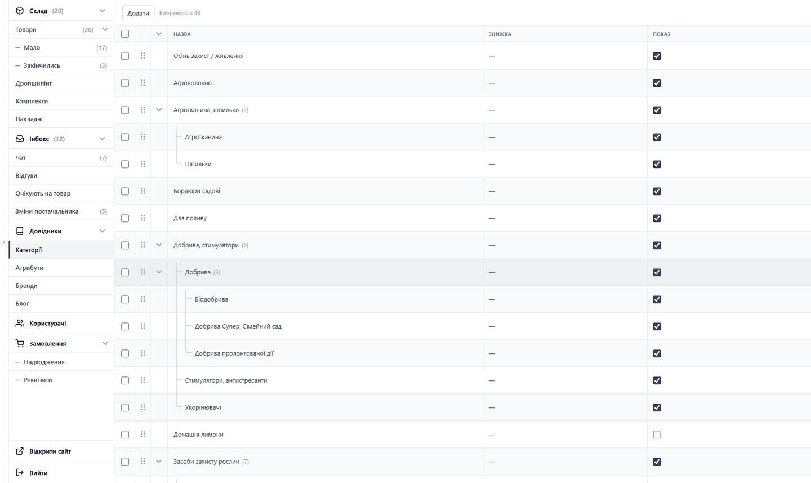
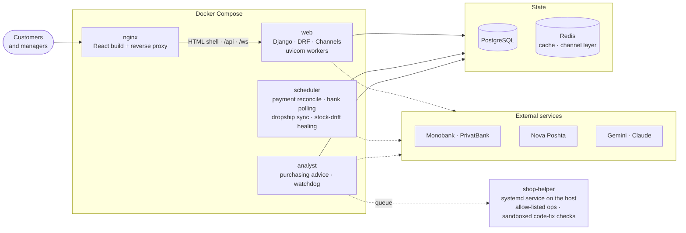

# Magiya Roslyn — e-commerce platform with a built-in CRM


A full-stack online store for garden and plant-care supplies — customer storefront, an operator CRM, payments,
logistics and AI agents — designed, built and deployed end to end. It runs in production at
**[magiyaroslyn.com](https://magiyaroslyn.com)** (the live storefront is in Ukrainian).

<p align="center">
  
</p>

| | |
|---|---|
| **Storefront** | React 19 SPA: faceted catalog, typo-tolerant search, bundles, cart, checkout, accounts, reviews, blog, video courses, live chat |
| **CRM** | Heavily customised Django Admin: inventory, orders, supplier invoices, payments, inbox with real-time counters |
| **AI agents** | A purchasing/ops *Analyst* with a watchdog and a guarded code-fix pipeline, a step-by-step *instruction agent*, vision-based description import, review moderation, receipt and invoice OCR, embedding-based catalog matching |
| **Integrations** | Monobank Acquiring, Monobank/PrivatBank statements, Nova Poshta, Gemini, Claude |
| **Scale of the code** | ~53k lines of Python, ~17k lines of TypeScript, 59 models, 230+ migrations, 1,000+ automated tests |

## Screenshots

<p align="center">
  
  
</p>
<p align="center">
  
</p>

**CRM** (Django Admin with a custom UI layer):

<p align="center">
  
</p>
<p align="center">
  
  
</p>

## What it does

### Storefront
- Catalog with category tree, facets and **typo-tolerant search** (PostgreSQL `pg_trgm` similarity over name, brand and description).
- Products with **variants** (pack sizes, factory vs. own repackaging from bulk), **bundles/kits**, stock-aware cart limits, favourites,
  "notify me when back in stock", reviews and questions.
- Checkout with **Nova Poshta** city / branch / parcel-locker / courier-address pickers, Monobank card payment, bank transfer, cash on delivery.
- **Video courses** (access by purchase, short-lived signed video URLs), a blog, and a live **chat widget**.
- SEO for a SPA without a pre-render step (see [docs/SEO.md](docs/SEO.md)), JWT auth with silent refresh, invisible anti-bot protection on public forms.

### CRM (operator back office)
- Product, variant and bundle editors with custom widgets: photo manager with **automatic background removal** and 1080×1080
  normalisation, drag-and-drop category tree, inline price/stock editing, per-order bundle composition edits.
- **Inventory**: write-offs, back-orders, low-stock alerts, bulk-bag ↔ repackaged-variant accounting, a stock audit command.
- **Supplier invoices**: photo → Vision OCR → fuzzy + embedding match to catalog variants → one-click stock receipt, with an exact revert.
- **Payments**: Monobank webhooks (ECDSA-verified), bank-transfer auto-matching from Monobank / PrivatBank statements with confidence scoring,
  payment-receipt screenshot OCR as an anti-fraud check — see [backend/orders/PAYMENT_MATCHING.md](backend/orders/PAYMENT_MATCHING.md).
- **Inbox** with real-time counters (Channels + Redis): payments, reviews, questions, waiting-for-stock, supplier changes, customer chat, Analyst findings.
- Dropshipping: supplier price/stock sync, multi-supplier shipments, PDF order receipts rendered by headless Chromium, printable leaflets and label sheets.

### AI agents
- **The Analyst** (`analyst` app, [docs/ANALYST.md](docs/ANALYST.md)): once a day it produces *purchasing advice* — the numbers (sales pace, seasonality,
  stock cover, people waiting for an item) are computed by plain code, and an LLM agent only interprets them through read-only tools. Every answer is
  validated server-side (quantity capped relative to the computed one, a reason is mandatory, unknown items are rejected) and the agent cannot write to shop data.
  A **watchdog** runs every few minutes (disk, backups, TLS, scheduler heartbeat, stuck jobs) and can fix the server by itself through an
  allow-listed helper — with a cool-down, a per-day cap, one action per kind per cycle, and findings the owner closed are never touched.
- **Guarded code-fix pipeline** (`analyst/codefix`, `ops/`): runtime errors are collected from the logs as sanitized "shapes" (no variables, request
  data or quoted values), a drafting agent proposes a patch, an *independent reviewer* model that never sees the raw error text judges it, and the
  host helper re-checks the patch against a **default-deny policy** (file allow-list, size limits, an AST-level check that forbids new dynamic
  constructs) and runs the tests in a network-less sandbox. Depending on the mode it only proposes, or deploys at night with a health check and
  automatic rollback. The rules live in code, not in prompts, and the host does not trust the web or analyst containers or the agent.
- **Instruction agent**: turns a bundle's raw usage text into structured, dose-checked instructions step by step with tools. Each step is verified by code
  (an invented dose is rejected on the spot) and the final result goes through the same deterministic validator again *outside* the agent. If the LLM
  quota runs out, the job is queued and applied later — only if the form was not changed in the meantime.
- **Description import with vision**: pasted images in a draft description are classified (photo / table / text / other); tables become real
  `<table>` elements, photos become media files instead of base64 blobs.
- **LLM-assisted editing** in the CRM through the Claude Code CLI with automatic fallback to the Claude API, plus rate and budget guards
  ([backend/core/limits.py](backend/core/limits.py)).
- **Review and question moderation** (`catalog/llm_moderation.py`): a Claude verdict (`pass` / `flag` with a short reason) when a review or a
  question is created. Criticism goes through; spam, insults and contact details are flagged; if the API fails, nothing is published automatically.
- **Payment receipt check** (`orders/screenshot_match.py`): Gemini Vision reads the amount, time and sender from the receipt a customer uploads,
  and the order is confirmed automatically only when exactly one bank-statement transaction matches within a ±2 hour window. No match is flagged
  as possible fraud; several matches go to a manager.
- **Order and write-off entry from a photo or free text**: a chat screenshot, a note or a handwritten list is parsed into an order or a stock
  write-off by a vision model with strict "extract only what is really there" JSON output. The endpoint saves nothing: it returns fields and
  candidate items that fill the CRM form for a person to confirm.
- **Embedding index**: Gemini embeddings of the ~1,000 variant names are stored in the database, so invoice and bundle matching survives restarts and
  API quotas.
- **Video to article**: audio of a YouTube video is transcribed (Gemini) and rewritten into a blog post by the same prompt as the normal pipeline.
- **Catalog feed for an AI plant assistant** (`catalog/flora_feed.py`): read-only endpoints that compose the same text and card for the full export
  and for incremental updates of an external assistant's vector index (RAG).
- **Telegram operator bot** (`telegrambot`, opt-in app; **work in progress, not deployed**): a Claude agent whose only tools are the shop's own
  functions — deny-by-default tool policy, user allow-list, per-command write limit, and an undo journal for every change.

## Architecture



| Layer | Technology |
|---|---|
| Frontend | React 19, TypeScript, Vite, Tailwind CSS 4, React Router 7, Axios |
| Backend | Python 3.13, Django 6, Django REST Framework, SimpleJWT, Channels (WebSockets) |
| Data | PostgreSQL (`pg_trgm`, `fuzzystrmatch`), Redis |
| AI | Anthropic Claude (CLI + API, agent SDK with in-process MCP tools), Google Gemini (embeddings, Vision) |
| Infra | Docker Compose, nginx, uvicorn, Let's Encrypt, Playwright/Chromium for PDFs |

## Engineering notes

A few problems that were interesting to solve (details are in the code and its docstrings):

- **Stock stays consistent under every path that touches it.** A deduction records what was actually consumed and restores exactly that on revert
  (no "set absolute value" rollbacks). For repackaged goods, the bulk bag and the sellable variant are kept in sync by an invariant, and a
  scheduled job detects and heals drift, logging every finding as an error.
- **Payments never depend on a single signal.** Webhooks are signature-verified, but a reconcile job also polls unpaid invoices, so a lost webhook
  cannot leave stock reserved forever. Bank-transfer matching scores candidates and either auto-confirms, queues for a human, or leaves the
  transaction unmatched.
- **SEO for a client-rendered SPA without pre-rendering.** Django injects `<title>`, canonical, Open Graph and JSON-LD into the built
  `index.html` per request and returns real 404s for missing products (no soft-404s); nginx proxies navigation requests to it.
- **Agents that cannot do harm.** In the Analyst, the code-fix pipeline and the (in-progress) Telegram bot the model gets only an explicit list of in-process tools
  (anything else is denied, even if a prompt asks for it); numbers and doses come from deterministic code and are re-validated outside the model;
  autonomous actions are allow-listed, rate-limited and reversible or journaled. For code changes the safety rules are enforced on the host with a
  default-deny policy and structural (AST) checks, and the reviewer is a separate call that never sees attacker-controlled error text.
- **Background work that fails loudly.** The scheduler runs in its own container with `close_old_connections()` around each cycle
  (a stale DB connection once silenced it for days), every sub-task is idempotent, a heartbeat lets the Analyst notice if it stops, and expensive
  LLM/embedding calls sit behind shared budget counters.

**Trade-offs, stated plainly:** the CRM is built on Django Admin rather than a second SPA — much faster to evolve for a small team, at the cost of
large template files with inline JavaScript. Some business logic also still lives in large view modules rather than a dedicated service layer.

## Repository layout

```
backend/
  config/        settings, URL routing, ASGI
  catalog/       products, variants, bundles, categories, stock, notifications, instruction agent, admin UI
  orders/        orders, shipments, invoices, payments, bank matching, Nova Poshta, PDF
  analyst/       purchasing advice, watchdog, error log, code-fix pipeline, host-ops client, inbox section
  chat/          WebSocket chat between customers and managers
  courses/ blog/ users/ core/ telegrambot/
  templates/     custom admin templates      static/  admin CSS/JS
frontend/src/    pages, components, context providers, API client
ops/             shop-helper: the allow-listed host service (ops queue, sandbox, rollback) used by the Analyst
docs/            deployment, Analyst operations, SEO notes
docker-compose.yml   .env.example
```

## Running locally

Requirements: Python 3.13, Node 22+, **PostgreSQL 17+** (SQLite is not supported — the schema relies on the `pg_trgm` and
`fuzzystrmatch` extensions). Redis is optional in development (the app falls back to in-process cache and channel layer).

```bash
# backend
cd backend
python -m venv venv && source venv/bin/activate        # Windows: venv\Scripts\activate
pip install -r requirements.txt

cat > .env <<'EOF'
DEBUG=True
DB_ENGINE=postgresql
DB_NAME=shop_db
DB_USER=postgres
DB_PASSWORD=postgres
DB_HOST=localhost
DB_PORT=5432
OWNER_EMAIL=you@example.com   # this account sees the owner-only CRM sections
EOF

python manage.py migrate
python manage.py createsuperuser
python manage.py runserver                              # http://localhost:8000  (CRM at /admin/)

# frontend (second terminal)
cd frontend
npm ci
npm run dev                                             # http://localhost:5173  (proxies /api, /media, /ws to :8000)
```

API keys (Monobank, Nova Poshta, Gemini, Anthropic, SMTP…) are only needed for the matching integrations.
See [.env.example](.env.example) for every setting. Production deployment with Docker Compose: [docs/DEPLOY.md](docs/DEPLOY.md).

## Tests and CI

```bash
cd backend && python manage.py test        # 1,000+ tests, PostgreSQL required
cd frontend && npm run build               # type-check (tsc) + production build
```

A GitHub Actions workflow ([.github/workflows/ci.yml](.github/workflows/ci.yml), started from the Actions tab) runs: `manage.py check`,
a migrations-in-sync check, the full backend test suite against a PostgreSQL service, and the frontend type-check and build.

## Notes

- All secrets live in environment files that are not committed; [.env.example](.env.example) documents the variables.
- The live shop serves the Ukrainian market. In this copy of the repository the user-facing strings (storefront text, CRM labels, e-mail templates), the LLM prompt files and the sample data are in English; the few places that still contain Ukrainian or Russian are word lists and patterns that match what customers and suppliers type (marked with comments). Code, comments, docs and commit messages are in English.
- Names, contact details, payment cards and other personal data in the code are placeholders.
- Screenshots were taken from a local development database.

---

All rights reserved — the source is shared for portfolio and code-review purposes.
